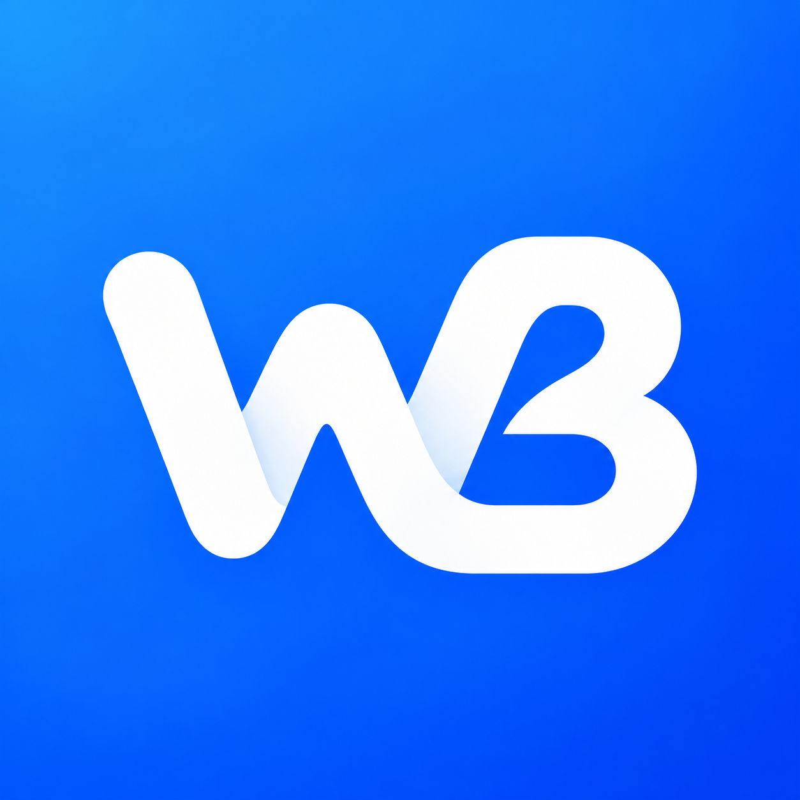

# Weibo Lite



**公开源码的非商业学习与个人体验项目，仅用于 Android 界面、网络请求及内容预览的技术研究。禁止用作任何商业用途。**

本项目与新浪、微博官方及其关联公司没有任何隶属、合作、授权或背书关系，不是官方客户端，也不作为官方产品的替代品。项目仅供个人学习交流、体验和预览公开内容，不用于商业运营、批量采集或内容再分发。

**建议用户优先使用正版新浪微博官方客户端：**

- [新浪微博 Android 官方下载入口](https://weibo.com/mobile/android.php)
- [微博官网的 Android 客户端介绍及下载入口](https://app.weibo.com/detail/325ugZ)
- [新浪微博官网](https://weibo.com/)

## 使用范围与权利说明

- 本项目原创代码和文档采用[自定义非商业学习使用许可](LICENSE)，仅供学习交流及个人体验，禁止商业用途。这不是 OSI 认可的开源许可证。
- 新浪、微博及相关名称、标识的权利属于其各自权利人；名称仅用于说明所访问的服务，不代表获得官方授权。
- 微博正文、图片、头像、视频及评论等内容的权利属于相应作者或其他权利人。本项目不拥有这些内容，也不向用户授予复制、传播或商业利用这些内容的权利。
- 内容通过用户设备向微博相关服务请求，不随本仓库提供内容数据库。短期缓存仅用于浏览体验；不要利用本项目批量采集、出售数据、冒用账号或绕过平台限制。
- 请遵守适用法律、微博服务条款及第三方许可证。非商业用途、学习用途和本声明本身不构成对侵权、违规或账号风险的免责保证。
- 若发现权利或许可证问题，请通过 [GitHub Issues](https://github.com/ives-cheung/Weibo_Lite/issues) 提供具体文件、权利依据和问题说明，以便核实、修正或移除。

## 功能与当前限制

Kotlin + Jetpack Compose 实现，Android 8.0（API 26）及以上，包名 `com.weibolite.android`。当前源码版本 **0.2.7**。

- 公开内容预览、热搜、微博及用户搜索、基础详情和第一页评论。
- 长文展开与收起；话题及提及显示蓝色；点击 `#话题#` 复制该话题。
- 图片浏览、浅色/深色主题、玻璃工具栏与弹簧气泡导航。
- 可选手动 Cookie 配置：Android Keystore AES-GCM 本机加密保存，禁止备份，不记录凭证日志。

尚未实现官方网页登录、账号关注时间线、点赞/评论/转发写入、视频播放或完整评论分页。互动区仅显示计数。平台接口并非本项目拥有或承诺获得授权的开放接口，可能随时改变、要求验证或停止可用；项目不承诺持续可用。

本项目仅申请网络权限，没有广告、统计或推送 SDK。Cookie 是敏感登录凭证，请勿提交到仓库、Issue、截图或聊天中。配置 Cookie 不等于已验证登录成功。

## 从源码构建

需要 JDK 17/21 和 Android SDK 35。在本机 `local.properties` 中设置 `sdk.dir`，不要提交该文件。

```sh
./gradlew :app:testDebugUnitTest :app:lintDebug :app:assembleRelease
```

release 构建当前使用本机 debug key，启用 R8 与资源压缩，属于个人测试配置。不要将其当作正式发行签名。仓库不提交 APK、签名密钥、构建缓存或本机配置；本机历史测试包仍留在 `dist/`。

## 来源、许可证与致谢

感谢 WeiboX、weibo-cli、Telegram Android 及 AndroidX、Kotlin、OkHttp、Okio、Coil、jsoup 等项目作者与维护者。

- [ACKNOWLEDGEMENTS.md](ACKNOWLEDGEMENTS.md)：参考项目、作者、核对版本、许可证及参考范围。
- [THIRD_PARTY_NOTICES.md](THIRD_PARTY_NOTICES.md)：实际依赖、版权及许可证说明。
- [docs/dependency-licenses.json](docs/dependency-licenses.json)：Gradle releaseRuntimeClasspath 解析的 67 个运行时组件及 POM 许可证来源。
- [licenses/](licenses/)：保留的第三方许可证文本。

参考项目各自的许可证互不替代；本项目许可不覆盖或修改任何第三方许可证。尤其是 WeiboX 未发现明确许可证，不应将公开仓库等同于允许复制或再分发。参考源码仅留在本机 `research/`，没有纳入本仓库或打包为项目源码。

当前 WB 融合图标使用 AI 辅助生成，文件位于 `assets/app-icon-ribbon-wb.png`，不是微博官方标识，不声称官方授权或独占商标权。

## 最近更新

- 0.2.7：点击话题复制，保留井号；相邻话题分别处理。
- 0.2.6：WB 融合带状图标与蓝色满版背景。
- 0.2.1–0.2.4：背景模糊、边缘折射、弹簧气泡导航、全文对齐与分组评论。

详细开发核对记录见 [docs/RESEARCH.md](docs/RESEARCH.md) 和 [docs/VALIDATION.md](docs/VALIDATION.md)。这些是开发记录，不是服务授权或法律合规证明。
